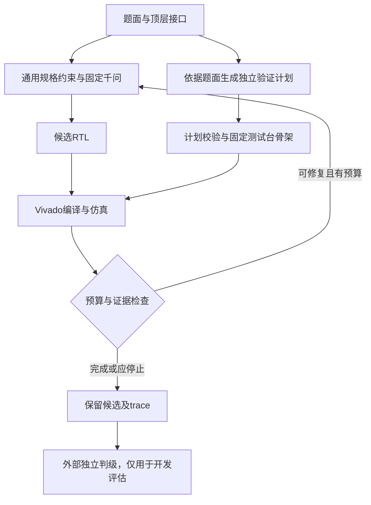

# RTL 本地智能体设计报告

版本：V11.1。报告整理日期：2026-10-30。能力与工程测试运行时依据提交 `f136c92a9476d65224ac4e33ecde45fe15c1baee`。105个能力样本和同一模型/API会话300个工程任务均已独立核验；保留一条客户端主动暂停造成的截止观察离群，完整网络隔离仍受环境权限限制。本稿用于审阅，所有结果均为开发测试，不是赛事正式成绩。

## 1. 方案概述

目标是在固定本地千问模型下，通过可检查的接口约束、工具反馈和有限修复提高可综合 RTL 的正确性。能力和相对基线增益是主要目标，同时控制模型调用和EDA耗时。没有足够可比证据时不计算正式增益，也不把预期70分当作已达成绩。

当前结论是：部署和接口的多项检查成立，功能正确率和自检可靠性仍是主要瓶颈。测试允许单题900秒内部预算；历史240秒开发批次仅保留为历史记录。

## 2. 总体架构



设计依据是将模型、确定性检查、EDA执行和外部判定分开。生成进程只接触题面与许可接口；外部参考答案和判题材料不进入模型上下文。智能体内部测试与开发者的外部参考判级是两条不同证据链。

## 3. 模型与推理栈

### 3.1 固定主模型

| 项目 | 内容 |
| --- | --- |
| 权重仓库 | Qwen/Qwen3-14B-GGUF |
| revision | `c75e7b2d0234068f674a1bacf548ea32e27ccd29` |
| 文件与量化 | `Qwen3-14B-Q4_K_M.gguf`，Q4_K_M |
| 大小 | 9,001,752,960字节 |
| SHA256 | `500a8806e85ee9c83f3ae08420295592451379b4f8cf2d0f41c15dffeb6b81f0` |
| 上下文与并发 | 32768 token，单槽，单GPU |
| 思考 | `enable_thinking=false` |
| 输出 | 客户端总上限16384；设计/修复8192、测试台3072等按用途预算；官方基线保持16384 |
| RoPE外推 | 无额外配置 |
| 显存证据 | 10月29日周期采样观测峰值14.883463168 GB；不是硬件高水位 |

### 3.2 候选选择的边界

本轮未进行不同模型的选型对照，始终使用同一千问主模型。历史异模型开发记录不用于证明当前方案优于千问基线，不将未执行的候选评测填成选型实验。

### 3.3 微调与辅助模型

未微调，未使用辅助模型。没有新增训练数据或其他生成模型。

### 3.4 推理栈

官方FPGA-CHINA环境的llama.cpp `0.4.0-dev`、commit `f114f91`，在W7900D/gfx1100上运行。模型监听`127.0.0.1:8000`，启用Jinja、全量GPU层加载、32768上下文、`--parallel 1`、`--no-context-shift`。投题服务监听环回7860。公开入口只转发投题端口，模型端口不公开。

## 4. 智能体设计

### 4.1 控制流

`run.sh`调用`agent.main`，解析题面接口并读取通用RTL规则，生成首稿。工具检查编译和仿真，计划解析器将独立验证计划装入固定骨架；失败时依据具体工具反馈及观察历史进行归因，决定修复DUT或处理测试台问题。每题输出`solution.v`及`trace.jsonl`，并保存候选选择依据。

### 4.2 修复与回退

默认最多3轮，所有模型和工具步骤共同受剩余墙钟限制。重复候选会停止；预算不足不再开展新步骤。超时或验证未完成时保留已有候选和失败原因，不把文件存在、进程返回0或内部PASS当作外部功能成功。外部开发评估不重投失败样本、不取多次最好结果。

### 4.3 上下文管理

按设计、修复、测试台及归因的不同职责分配调用预算。反馈采用相关编译错误和有限观察记录；保留接口及规格约束，避免将长工具日志整体加入下一轮。默认不增加独立行为规划调用，减少未证明必要的模型往返。32768上下文容量与实际单次输出预算分别声明。

### 4.4 自我验证

验证计划只依据规格生成，不提供DUT源码或外部参考。确定性校验检查符号声明、单表达式和参考状态依赖等条件。归因要求绑定真实输出、激励及时间历史；已知十六进制前导零先规范化后检查有效位宽，保留X/Z与真实溢出检查。V11.1修复的是格式误拒，未证明模型语义判断因此改善。

## 5. 技能包

| 文件/机制 | 用途 | 条件及已验证边界 |
| --- | --- | --- |
| `skill/rtl_rules.md` | 位宽、符号、复位、使能和时序约束 | 设计及DUT修复；没有单条规则的同步消融成绩 |
| `skill/verification_rules.md` | 依据规格建立独立期望与激励 | 测试计划与归因；仍存在自检误报 |
| 结构化计划校验 | 拒绝非法符号、参考回读DUT等问题 | 本地机制控制；不等同模型能力成绩 |
| 有限预算与候选保留 | 超时退出、保留可检查产物 | 本地控制及云端短时限清理已验证 |

规则来自多类失败：算术位宽/符号、复位与使能次序、采样沿、参考状态和握手更新。V11.1恢复V10的设计/验证提示，并修正已知前导零误拒，避免将单题答案和题号分支写入运行时。315项本地回归通过；六份归档回复重放中消除两次格式拒绝，另外四份结果不变。该结果只证明格式处理的机制变化，不证明新增两道功能通过。

没有同一轮、同配置的V11.1技能开关A/B实验，因此不宣称某条规则带来了可量化提分。

## 6. 实测结果

### 6.1 环境与采样

已核验数据为21道已参与开发的题，5组、每题每组一次，共105个样本。2026-10-29完成93个，10月30日补齐其余12个从未开始的样本，没有重投旧失败。两天间重启过模型服务，但权重、推理配置、智能体、题面与判题材料保持一致，单题900/910秒预算不变。不是VerilogEval完整题库或未见题评测。Vivado2026.1，器件`xczu3eg-sbva484-1-e`，时钟5ns；每个样本先验证正确参考，再生成和独立判定。105个参考全部L3，独立环境错误0。

### 6.2 分级与基线

| 数据范围 | L0 | L1 | L2 | L3 | 合计 |
| --- | ---: | ---: | ---: | ---: | ---: |
| 完整前四组 | 10 | 44 | 0 | 30 | 84 |
| 完整第五组 | 4 | 10 | 0 | 7 | 21 |
| 完整合计 | 14 | 54 | 0 | 37 | 105 |

五组L3依次为7、6、8、9、7。完整五组功能均值37/105（35.2%），开发题集分级系数均值为0.45524。两者不是同一个指标，也不是正式比赛得分。L1表示编译通过但未通过功能，等级递进成立后才计L3。

本轮只验证原样基线的协议入口，没有重跑完整能力基线。没有同批可比B值，不计算正式归一化增益或比赛总分。历史基线的独立单样本记录与本轮900秒五组计划不同，单列保留。

### 6.3 pass@1与pass@5

每题五次的功能pass@1均值为35.2%。21道题中9道至少一次L3，因此功能pass@5为9/21（42.9%），仅作稳定性诊断；不以最好一次计分，不用pass@5替代pass@1，也不把已参与开发的题称作泛化证明。

### 6.4 时间与工程验收

105个样本的生成阶段总4442.659秒，328次模型调用，生成阶段均值42.311秒。新增12个样本生成415.693秒、32次调用。该口径不含外部正确参考与独立判级总耗时，也不含另行工程冒烟。900/910秒是预算上限，不是每题实测耗时。不同历史预算、机器负载及采样批次不用于因果提速结论。

| 检查 | 已核验证据 |
| --- | --- |
| 干净启动、重复启动 | 固定权重摘要、实际进程参数、重复启动PID不变、真实参考L3 |
| HTTP | 鉴权401/401/200；agent及原样baseline接单202、轮询done、nonce去重 |
| Linux进程管理 | 终止HTTP子进程后监督进程重启；真实短时限任务清理，模型PID不变 |
| 上下文 | 32600输入token、16输出token，无截断，38.50秒；为合成负载 |
| 显存 | 周期观测峰值14.883463168 GB，低于32 GB；不保证采样间瞬时峰值 |
| 压力 | 当前同一模型/API会话300/300任务完整核验，953次LLM调用、独立环境错误0；未观察到进程重启。旧会话16次另列，不混算 |
| 公网 | 10月30日外部客户端完成401/401/200、接单202、nonce去重、轮询done和非空代码/真实trace回传；临时入口随后关闭。返回RTL独立L1，237/257失配；协议通过不表示功能通过 |
| 完整断网 | 新网络命名空间被环境权限拒绝，未完成，不能以去代理代替隔离证明 |

10月30日另行执行了无代理的完整生成与Vivado判级链路，得到L3；公网直连探测分别不可达或超时。这个结果证明该具体本地链路可运行，仍不证明容器已实施完整网络隔离。

300个工程任务循环三道公开题、deadline90秒，独立等级29L0/113L1/158L3，不加入105个能力样本。服务elapsed均值31.586秒、P95为54.662秒、最大75.296秒；客户端最后轮询观察P95为58.109秒。299条客户端观察在deadline+20内；`stress_022`因主动暂停测试客户端观察为1008.175秒、服务elapsed43.742秒，保留原样，不声称300条均按时完成。row总计时另含独立EDA判题，不能用于替代HTTP墙钟。本轮3273个显存样本、错误0，观测峰值14.864891904GB；此前较大峰值14.883463168GB仍保留。测试模型/API及随机令牌已清理，实例保留；之后于10月30日15:45完成正式公网部署及网址表单报送。作品材料提交另按用户安排。

### 6.5 结果分析

91/105达到编译等级，但54个独立功能失败；这比单纯提升语法合法率更值得优先处理。28个内部自检PASS中9个被外部功能判定否决，说明自检结果还不能可靠预测真实功能。当前证据不足以把错误归因于Vivado许可证、环境崩溃或换用其他模型。

## 7. 复现说明

### 7.1 镜像与文件

使用官方基础镜像`fpgachina-rtlhls@sha256:a7cf627e11708e8a6dcd9de689ff934f7b450b79369ebc7bb0217e8b54d81e56`。它是赛事方私有兜底镜像，队伍没有将本地Docker构建写成已验证。权重预先按公开revision下载、校验后置于持久盘；运行时不下载模型。

### 7.2 启动环境

```bash
export INFERENCE_BACKEND=llamacpp
export MODEL=/workspace/models/Qwen3-14B-Q4_K_M.gguf
export MODEL_NAME=Qwen3-14B-Q4_K_M LLM_MODEL=Qwen3-14B-Q4_K_M
export LLAMA_SERVER=/opt/llamacpp/llama-server
export LLM_BASE_URL=http://127.0.0.1:8000/v1 LLM_API_KEY=local-placeholder
export MAX_LEN=32768 LLM_MAX_TOKENS=16384 LLM_TEMPERATURE=0.2
export ROCBLAS_TENSILE_LIBPATH=/opt/llamacpp/rocblas/library
export HIP_VISIBLE_DEVICES=0 RTL_SIMULATOR=vivado
export AGENT_TMP=/var/tmp EDA_TMP=/var/tmp/eda SELFTEST_TMP=/var/tmp
export XILINXD_LICENSE_FILE=2100@vivado-lic.fpgachina.svc.cluster.local
export FLEXLM_TIMEOUT=300000000 NO_PROXY=127.0.0.1,localhost
bash serve/start.sh
```

投题令牌通过环境变量`FPGACHINA_TOKEN`安全注入，不写入报告、仓库或公开截图。当前健康接口实时读取获配GPU，不再依赖`VRAM_GB`启动快照；运行`bash serve/run_api.sh start`。健康检查与鉴权通过后再建立官方隧道。令牌与正式网址报送按赛事通知执行。

### 7.3 单题及基线

```bash
bash run.sh <input_dir> <out_dir>
bash run_baseline.sh <input_dir> <baseline_out_dir>
```

输入为`prompt.txt`；输出为`solution.v`和`trace.jsonl`。基线保持官方`baseline.py`、`run_baseline.sh`原文件，单次生成、temperature=0、MAX_TOKENS=16384、TIMEOUT_S=840；共用同一主模型。`manifest.generation`只按官方约定传思考等配置，不定制基线提示或加修复。

### 7.4 证据复核

原93样本及工程验收归档`checkpoint-20261029T144030Z.zip`，SHA256 `d64c8895100a15d1513b1fae81eabc50f357a18852c46dbf58f81d43926baf3c`，451个索引文件。新增12样本的`cloud-evidence.zip`为609077字节，SHA256 `bb54336d59da4330c7844d30b7d2cb4727b84da4f86c5aa32e0990db743a3ff6`，626个索引成员，完整批次核验通过。已检查CRC、文件集合、每文件摘要、冻结输入、租约、模型身份及参考判级。`capability-complete-verified.json`合并105个互不重投样本；原证据和过期租约不改写。

完整工程归档`operator-checkpoint-20261030T064105Z.zip`为7422823字节，6996个索引文件，SHA256 `c6862c608518d9e551a70105628674378d2bd7b7cca0c48c0f8e7d78bf35f2bc`。只读完整核验覆盖300份原始HTTP/RTL/trace/独立判定、两份租约、原模型绑定、API启动时间、完整supervisor日志及所属进程/端口/临时令牌清理。完整分析见`docs/v11p1_engineering_20261030.md`；未将工程循环公开题写作新能力成绩。

### 7.5 环境依赖

需要Python标准库、Bash、setsid、Vivado2026.1及可用许可证、同版llama.cpp与兼容ROCm。临时EDA工作目录必须在节点本地`/var/tmp`，不能使用容量有限的`/tmp`存放大型工作区。持久结果放`/workspace`。Notebook、终端与服务进程的环境变量作用域分别检查。完整断网、销毁后重新挂载复现及正式投题长期稳定性仍未全部证明。

## 8. 失败分析

### 8.1 主要类型

| 类型 | 证据 | 判断边界 |
| --- | --- | --- |
| 功能语义错误 | 54个L1，涉及采样沿、使能、符号算术、状态更新和握手 | 规格误读或覆盖不足是合理推断，逐个根因仍须结合RTL/轨迹 |
| 自检误报 | 28个内部PASS中9个外部失败 | 内外共享误解或测试覆盖缺口；不能将自检PASS当作答案正确 |
| 计划不合法 | 未声明符号、依赖次序、参考状态读取DUT输出、非单表达式 | 校验能拒绝非法计划，但拒绝本身不等于修复模型 |
| 修复无效 | 15个样本以重复候选停止 | 追加调用可能重复原错误，不能仅靠增加轮数保证改善 |
| 编译未成立 | 14个L0 | 与功能错误分开，保留具体工具反馈 |

### 8.2 无效或未证实的尝试

V11曾重写通用提示，历史同题7/21，相比V10的8/21未提升，虽生成耗时下降。两轮历史单次数据不能证明因果。V11.1保守恢复V10提示，并修正前导零误拒；局部格式修复成功并未消除语义归因的错误：某归档回复的数值期望与理由相互矛盾，规范化后仍可能误责正确DUT。增加验证和诊断调用也没有消除自检误报，未把调用量当作质量证明。另行公网冒烟中，返回代码用逐位直通代替聚合运算，且常量循环访问超出输出位宽；代码可编译但237/257检查失配。这是通用边界检查与功能语义约束的缺口，未为此加入题目专用答案或重投请求。

### 8.3 适用边界

当前数据仅覆盖21道开发题。多时钟、复杂协议、长题和不同分布的泛化未证明。测试卡容量大于赛规32GB上限，使用周期实测限制，不能按卡总容量扩展预算。网络权限阻碍完整隔离验收，不能将一次公网失败外推成所有外部访问均被阻断。

## 9. 可复用设计与证据

1. 结构化验证计划及确定性检查：将测试台格式、符号和依赖错误与DUT错误分开。相关机制回归315项通过，但没有宣称独立提分。
2. 绑定实际观察的失配归因：要求输出、激励和历史可追溯；六份归档重放消除两次前导零误拒，同时公开保留语义误判。
3. 独立模型身份与判级证据：实际权重摘要、进程参数及105个正确参考控制可追溯，28个自检PASS中9个误报明确公开。这是工程可检查性结果，不冒称能力创新已获正式分数。

## 10. 达成度与后续方向

已实现可运行的固定千问RTL生成、有限修复、异步接口和多项云端工程验证。尚未证明70分目标、稳定增益、完整断网运行或正式评测长期在线。优先改进规格约束、独立期望与覆盖质量，再考虑减少低收益诊断和格式修复调用；本轮验收期间未修改运行时和技能。

## 11. 参考来源

- 官方RTL仓库：https://gitee.com/Vickyiii/rtlagent2026 ，采用`fc8e26a5828b7222e9db439cee29128bcf4f8865`；2026-10-30远端master仍为此提交。
- 同版本`SCORING.md`、`docs/API_CONTRACT.md`、`docs/SUBMISSION.md`、`docs/FAQ.md`、`REPORT_TEMPLATE.md`。
- 用户提供、落款2026-10-29的《AMD本地智能体赛道初赛提交要求》：补充公网网址报送与作品材料要求；报送表单为https://iuzln7fb.jsjform.com/f/u2hFsr 。
- 权重：https://huggingface.co/Qwen/Qwen3-14B-GGUF/tree/c75e7b2d0234068f674a1bacf548ea32e27ccd29 。
- 工程证据：`docs/v11p1_acceptance_20261029.md`、`docs/v11p1_regression_fix_20261029.md`及上述原始归档。历史开发日志另存，不混入当前统计。

## 12. 大模型协作记录

### 12.1 模型与工具

运行时主模型固定Qwen3-14B-Q4_K_M，版本见第3节。Codex协助代码组织、工具调用、云端操作、证据核验和报告整理；会话未可靠提供每次Codex底层模型版本，不从产品名推断具体版本。Vivado2026.1执行云端判定；Icarus执行本地控制；Git保存版本。历史商业模型记录只作历史，不用于当前模型效果对照。

### 12.2 来源与判断

方案经用户约束与Codex协作形成：固定千问、保持官方基线、只测最新版、不针对题号优化、先修回归等来自明确任务约束；具体代码组织和检查机制由协作提出并依证据验证。没有将公开项目的通用做法声明为独有原创。

### 12.3 被采纳且有验证的建议

将独立判定与内部自测分开，在完整105样本中揭示9个自检误报；按规范化数值检查前导零，六份重放中消除两次格式误拒；用真实短时限请求检查子进程与临时目录清理，而非仅检查返回码。这些结论分别由原始判级、归档回复和进程证据支持。

### 12.4 错误建议与纠正

V11新增位宽检查错误地把十六进制显示字符数当作有效位宽；归档重放发现后修正。部分模型归因的数值与理由矛盾，仍可能责错DUT，报告保留这一反例。此前把用户一次“已销毁”确认当作当前实例状态，在用户更正后撤回该结论并保留原历史，未用停止模型进程代替平台销毁证明。

### 12.5 最终判别

使用冻结输入、外部权重/进程身份检查、正确参考控制、独立仿真综合、原始trace和归档摘要交叉核验。当前真实结论是部分能力与工程验收完成，仍有补测和环境权限缺口；不以助手叙述、自检PASS或本地测试替身替代真实云端证据。

## 13. 附录与交付状态

关键实现位于`agent/main.py`、`agent/prompts.py`、计划解析及验证模块、`skill/`和`serve/`。完整逐题记录见能力归档，各失败样本及中断原因均保存。设计报告正文保持匿名，不包含队名、成员或院校。

私有仓库及赛事协作者访问已核验。完整105样本及同一会话300个工程任务均已合并核验。匿名报告及1分55秒字幕演示审阅版已生成，视频包含25帧验收中途的实际云端画面，并以字幕区分最终结果及保留的客户端暂停离群。测试时192份运行文件与被测Git归档逐字节一致。此后按用户授权进行交付维护，补齐启动默认值、许可与文档并修正实时显存字段；agent、runtime skill、原样基线、模型与推理设置保持不变。既有测试结果不改写为维护后重新生成的样本。

按10月29日后续通知，10月30日24:00前须在指定表单报送正式公网网址与仓库；10月31日10:00封存并开始在线投题；11月4日18:00交报告、视频、代码包与仓库链接。代码备份固定参评版本，后台服务仍须在线。正式网址及仓库表单已于10月30日15:45提交成功，原实例获准继续在线；作品系统提交本轮不处理。通知提示删除可能影响持久盘，不执行实例删除。


当前交付维护和已完成正式部署状态见 [验证摘要](docs/validation_status_20261030.md)。启动所需默认模型配置已同时内置于 Dockerfile 与 serve/defaults.sh；上述 export 清单用于说明实际配置，标准路径下无需手工逐条设置。
