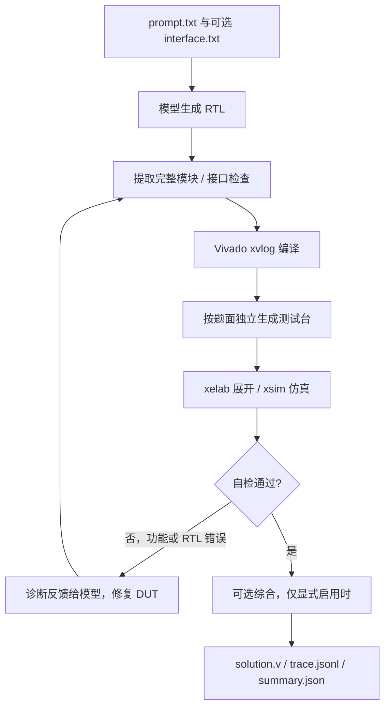

# RTL 智能体核心源码与解读

这份说明对应工作区 `readable-rtl-agent` 的现有实现，整理日期为 2026-10-20。源码阅读包保留原始程序，解读另放在本文，便于对照。包内没有模型权重、Vivado、ROCm 或许可证；它是核心源码阅读与运行包，不是完整参赛镜像。

## 1. 先理解两个不同的对象

- **智能体程序**：Python 与 Shell，负责读题、调用模型、启动 EDA 工具、收集日志并修复。
- **生成的硬件程序**：Verilog/SystemVerilog，例如最终的 `solution.v`。Vivado 仿真和综合的是它。

本项目的核心价值是把模型生成与真实工具反馈接起来。模型输出代码后，程序实际启动编译器和仿真器，再根据诊断修改候选，最后返回已经达到最高自检阶段的版本。

## 2. 阅读顺序与代码地图

以下行号对应本次打包源码；后续代码变更可能使行号移动。

| 顺序 | 文件与入口 | 负责什么 |
| --- | --- | --- |
| 1 | `agent/main.py:76`，`solve()` | 一道题的生成、验证、修复闭环 |
| 2 | `agent/prompts.py`，`DESIGN` / `TESTBENCH` | 告诉模型如何写 DUT 和独立测试台 |
| 3 | `agent/llm.py:87`，`LLM.chat()` | 调用 OpenAI 兼容模型接口，并限制请求总时长 |
| 4 | `agent/interface.py:29,78` | 提取 HDL、检查顶层模块与端口 |
| 5 | `agent/verification.py:307,326,368` | 编译、仿真及可选综合 |
| 6 | `serve/serve_api.py:199,305` | HTTP 请求、单任务队列、超时与进程清理 |
| 7 | `run.sh`、`serve/start.sh`、`serve/llamacpp.sh` | Linux 任务入口与本地模型启动 |
| 8 | `demos/detect_1101/solution.v` 与 `tb.sv` | 不调用模型即可阅读、仿真的硬件示例 |

`baseline.py`、`run_baseline.sh` 是保留的官方基线，不是智能体改写后的主流程。

## 3. 核心数据流



图表示正常路径。工具缺失、许可证错误、请求失败或时间耗尽，会提前结束，并尽量返回已保存的候选。默认最多三轮；默认 `run.sh` 没有启用综合。

### 输入与输出

输入目录必须有 `prompt.txt`；有明确端口约束时可增加 `interface.txt`。生成端不读取任务目录里的 `tb.sv`、`ref.sv` 或 `reference/`。

| 输出 | 用途 |
| --- | --- |
| `solution.v` | 当前选中的完整 DUT；超时后也可能有已保存候选 |
| `trace.jsonl` | 每行一个事件：模型调用、接口检查、工具状态、耗时与诊断摘要 |
| `summary.json` | 选中轮次、检查结果、停止原因与 token 数 |
| `generated_tb.sv` | 智能体根据题面生成的自检测试台 |
| `round_XX/` | 每轮候选、工具日志与结果 JSON；仿真成功时通常有波形 |

不要只看进程退出码判断成功：`run.sh` 为履行产物约定可能返回 0；功能状态应结合 `summary.json`、仿真日志及外部评测。

## 4. `main.py`：为什么能够自动修复

`solve()` 做五件事：读任务、生成候选、调用工具、保存候选、决定是否继续。

下面是流程缩写，省略了完整错误处理，不能代替包内可执行源码：

```python
for round_no in range(1, max_rounds + 1):
    code = generate_or_repair(task, previous_code, feedback)
    check_interface(code)
    lint = tools.lint(code)
    if lint_failed:
        feedback = lint.log
        continue
    if testbench_not_created:
        tb = generate_testbench(task)  # 这次调用不提供 DUT
    sim = tools.simulate(code, tb)
    if sim_failed:
        feedback = sim.log + fixed_testbench
        continue
    save_best_candidate(code)
    break
```

### 及时保存，避免最后一轮失败丢掉前面的结果

`main.py:137` 的真实代码：

```python
def preserve(code: str, rank: int, round_no: int, checks: dict):
    nonlocal best_code, best_rank, best_round, best_checks
    if rank >= best_rank:
        best_code, best_rank, best_round, best_checks = code, rank, round_no, dict(checks)
        save_solution(output / "solution.v", code)
```

这里 `rank` 是程序内部选候选的次序：

| rank | 内部含义 |
| --- | --- |
| 1 | 已提取完整模块，且通过当前接口检查门槛 |
| 2 | 本地编译检查通过 |
| 3 | 智能体生成的测试台仿真通过 |
| 4 | 显式开启的本地综合检查通过 |

同等级采用较新的候选，低等级不能覆盖已保存的高等级候选。`save_solution()` 用临时文件加原子替换，降低中断时留下半个文件的可能。

**这些 rank 不是赛事 L0/L1/L2/L3，更不是正式得分。** 例如 Vivado 的本地 lint 仅调用 `xvlog`，不等同于包含展开步骤的完整官方编译判定；模型自建测试台也不能代替官方参考与隐藏测试。

### 修 DUT 与修测试台的边界

初次生成测试台的模型调用只看题面及接口，不看 DUT。之后通常固定测试台，功能失败时修 DUT。代码仅对识别到的测试台语法/系统任务错误开放一次测试台修复，而且这次调用仍不提供 DUT；出现 `RTL_AGENT_FAIL` 的功能失败不走该分支。

这是降低“为通过测试而放宽判定”的措施，但模型仍可能误解题目，测试台也可能漏测或误判，不能据此声称功能已被证明。

## 5. `llm.py`：模型适配与超时

`LLM.chat()` 把 messages、模型名、生成长度等封装为 OpenAI 兼容的 `/chat/completions` 请求。HTTP 请求放在独立 Python 子进程里，父进程通过 `subprocess.run(timeout=...)` 限制总等待时间，避免连接持续返回数据却超过题目预算。

`manifest.json` 的白名单生成设置会进入请求；本地后端启动脚本也读取同一份配置，用来保持与保留基线一致的模型思考开关。请求密钥只从环境变量读取，源码包不含实际密钥。

开发时可适配 DeepSeek 等接口；参赛本地部署通过 `run.sh` 指向 `http://127.0.0.1:8000/v1`。直接调用 Python 而没有设置环境变量时，`LLM` 存在远程接口默认值，因此本地复现应明确设置 `LLM_BASE_URL` 与 `LLM_MODEL`。

## 6. `interface.py`：它能检查什么

- `extract_verilog()` 去掉思考段，从代码块中选出包含目标顶层的完整 HDL，并保留辅助模块。
- `check_interface()` 对可可靠解析的显式 `interface.txt` 严格检查端口集合、方向和可解析位宽。
- 仅从题面推断的接口属于提示性检查；复杂声明无法可靠解析时会记录跳过，并不会一概拒绝代码。

它是轻量文本检查器，不是完整 SystemVerilog 编译器；参数化位宽、复杂类型及语义仍依赖 EDA 工具。`main.py` 的禁用构造正则也只是输入筛查，不构成安全隔离环境。

## 7. `verification.py`：实际运行哪些 EDA 命令

Vivado 后端的核心调用顺序如下，完整参数与状态判断见源码：

```text
lint:     xvlog --sv rtl.sv
simulate: xvlog --sv rtl.sv tb.sv watchdog.sv
          xelab tb __rtl_agent_watchdog ... --snapshot rtl_agent_snapshot
          xsim rtl_agent_snapshot --tclbatch run.tcl
synth:    vivado ... -source synth.tcl     # 仅显式启用时
```

仿真要求明确的独立 `RTL_AGENT_PASS` 行，并检查失败/致命诊断；仅仿真进程返回 0 不足以判通过。工具运行有主机超时和仿真 watchdog，并清理相关子进程。临时 EDA 工作区结束后清理，日志、小型证据与波形按实现复制到输出目录。

综合使用 `synth_design -mode out_of_context`，保存检查点及资源/时序报告。它没有自动完成布局布线，也不能仅凭此宣称时序收敛。默认 `run.sh` 不传 `--synth`；此前云端展示的外部 L3 结果来自另外运行的评测流程，不能混为这个默认入口的内建步骤。

## 8. `serve_api.py`：如何接入评测请求

服务提供健康检查、异步提交和任务查询。提交后进入单 worker 队列，避免多道题同时挤占一个模型或 EDA 资源。非空 `nonce` 在本次服务进程生命周期内用于重复请求去重；它不是持久数据库。

`solve()` 包装器把输入写到临时目录，以独立进程组启动 `run.sh` 或未改动的 `run_baseline.sh`。排队时间计入总预算；超时会停止进程组，随后读取已经落盘的代码与轨迹。任务状态 `done` 表示处理结束，不表示功能正确。

健康检查的工具存在性不等于许可证验证；VRAM 配置字段也不是实时显存测量。

## 9. 一份具体 RTL：允许重叠的 1101 检测器

`demos/detect_1101/` 是包内已有的教学示例，并非隐藏测试答案。核心片段来自 `solution.v`：

```verilog
always @(posedge clk) begin
    if (reset) begin
        history  <= 3'b000;
        filled   <= 2'd0;
        detected <= 1'b0;
    end else begin
        detected <= (filled == 2'd3) && ({history, in} == 4'b1101);
        history  <= {history[1:0], in};
        if (filled != 2'd3)
            filled <= filled + 1'b1;
    end
end
```

- `history` 保存此前三个输入；当前 `in` 与旧 `history` 拼成四位窗口。
- 非阻塞赋值 `<=` 在右侧读取旧寄存器值，因此比较使用“此前三位 + 当前一位”，在当前上升沿后登记结果。
- `filled` 饱和到 3，避免复位后历史位尚未填满时误判。
- 输入 `1101101` 时，在第 4、7 个有效采样沿后输出检测脉冲；每次命中后继续移位，因此允许重叠。
- `reset` 是同步、高有效复位；这由敏感列表和分支共同决定。

配套 `tb.sv` 在下降沿驱动输入，上升沿后 `#1` 比较，避开非阻塞更新的采样竞争。它检查重叠、全部 256 个八位输入串、带复位的确定性随机序列，并用 `!==` 将未知态也计为失败。它是该示例的验证，不代表整个赛题集覆盖率。

## 10. Linux 下如何运行

### A. 只仿真包内示例，不调用模型

前提：Linux 中 Python >= 3.10，Vivado 已安装、环境已加载且许可证可用。解压后进入源码根目录：

```bash
python3 scripts/simulate.py \
  --source demos/detect_1101/solution.v \
  --testbench demos/detect_1101/tb.sv \
  --backend vivado --top TopModule \
  --output output/detect_1101 --timeout 120
```

查看 `result.json` 的 `status`、`simulation.log` 和输出目录中的波形。没有 Vivado 时可选已安装的 `iverilog` 后端做开发自测；这不替代赛事要求的工具链。

### B. 使用已准备好的本地 GGUF 模型生成并自检

以下路径是配置示例，需要改成机器上的实际文件；命令本身不会安装模型或推理后端：

```bash
export PYTHON_EXE=python3
export MODEL=/workspace/models/Qwen3-14B-Q4_K_M.gguf
export LLAMA_SERVER=/opt/llamacpp/llama-server
export INFERENCE_BACKEND=llamacpp
export MODEL_NAME=Qwen3-14B-Q4_K_M
export LLM_MODEL="$MODEL_NAME"
export LLM_BASE_URL=http://127.0.0.1:8000/v1
export LLM_API_KEY=local-placeholder
export AGENT_TMP=/var/tmp
export EDA_TMP=/var/tmp/eda

bash serve/start.sh
bash run.sh demos/detect_1101 output/generated_detect_1101
```

尽管示例目录含有现成 DUT/TB，这个生成入口只读题面与可选接口，不读取它们作为答案。`serve/start.sh` 仅启动常驻推理进程；HTTP 服务是独立入口：

```bash
# FPGACHINA_TOKEN 从部署环境提供，不要写入源码或报告。
python3 serve/serve_api.py --help
```

如果想在本地闭环额外执行综合，可替换任务命令为：

```bash
python3 -m agent.main --input demos/detect_1101 \
  --output output/generated_with_synth --backend vivado \
  --max-rounds 3 --deadline 900 --synth
```

此前核心推理/评测在 Linux 云端环境运行；本文本次仅整理源代码与解读，没有重新启动云实例或重新做整套 Linux 评测。历史证据与可视化结果在另行提供的评委材料包中。

## 11. 向评委解释时抓住三点

1. **闭环能力**：生成不是结束，真实编译/仿真诊断会进入下一轮修复。
2. **证据可查**：候选、模型调用摘要、工具日志、仿真波形和停止原因都有落盘位置。
3. **结论有边界**：自建测试通过、外部公开任务评测通过、正式隐藏任务成绩，是不同层面的证据。

源码包只收录实现、配置说明和一个教学示例，没有嵌入实际 API 密钥、账号信息或云端个人运维记录。`SOURCE_INDEX.json` 列出逐文件来源及 SHA-256，便于核对打包源码是否与工作区相同。
